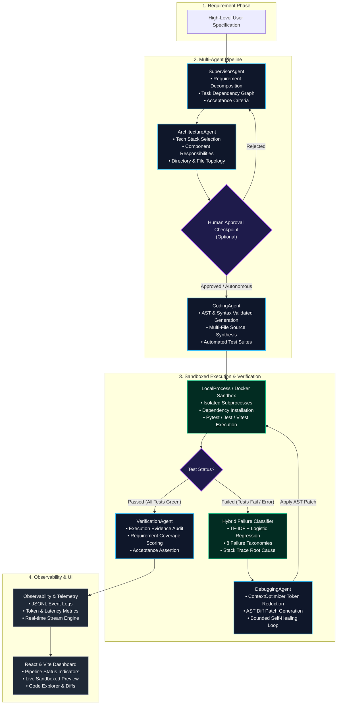
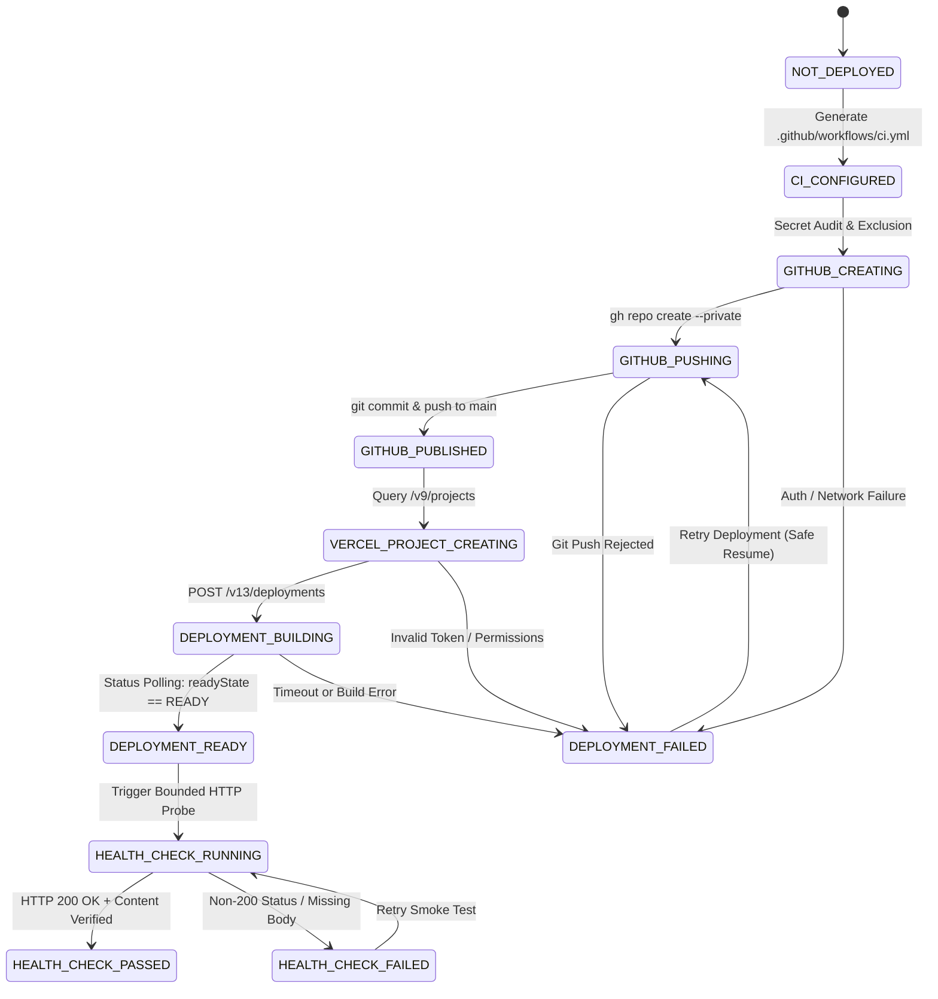
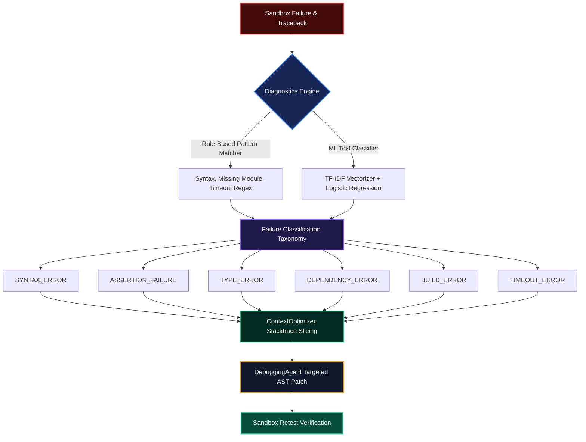

# 🤖 DevAgents — Autonomous Multi-Agent Software Engineering Platform

<div align="center">

[](https://www.python.org/)
[](https://fastapi.tiangolo.com/)
[](https://react.dev/)
[](https://www.typescriptlang.org/)
[](https://vitejs.dev/)
[](https://github.com/features/actions)
[](https://vercel.com/)
[](https://docs.pytest.org/)
[](#license)

<br/>

**Transform natural language requirements into fully architected, verified, self-healed, and live-deployed web applications.**

[Key Features](#-key-capabilities) •
[Architecture Flowchart](#-multi-agent-system-architecture) •
[DevOps Pipeline](#-autonomous-devops-github--vercel-pipeline) •
[State Machine](#-deployment-state-machine) •
[Empirical Benchmarks](#-empirical-research-benchmarks) •
[Quickstart](#-quickstart--installation) •
[API Reference](#-rest-api-reference)

</div>

---

## 🌟 Executive Summary

**DevAgents** is an autonomous software engineering system designed to bridge the gap between high-level prompt specifications and production software delivery. It orchestrates a specialized committee of AI agents to autonomously plan, architect, synthesize, test, diagnose, self-heal, verify, publish to private GitHub repositories, enforce CI/CD quality gates, and deploy live to Vercel cloud infrastructure.


---

## 🏗️ Multi-Agent System Architecture

DevAgents decomposes the software engineering lifecycle into 6 collaborating specialized agents coordinated through a unified, observable `ProjectState`:



---

## 🚀 Autonomous DevOps: GitHub & Vercel Pipeline

Once code generation and sandbox verification pass, the **DevAgents Cloud Deployment Engine** executes a zero-touch, secure publication and live hosting workflow:

```mermaid
sequenceDiagram
    autonumber
    actor Developer as Developer / Dashboard
    participant Backend as DevAgents API (FastAPI)
    participant Manager as DeploymentManager
    participant GitHub as GitHub CLI & Service
    participant CI as CIService (Actions Generator)
    participant Vercel as Vercel REST API Client
    participant Health as HealthCheckService
    participant Target as Live Production Host

    Developer->>Backend: Trigger Deployment (POST /api/runs/{id}/deploy)
    Backend->>Manager: deploy_run(project_name, files, is_private=True)
    
    rect rgb(15, 23, 42)
        Note over Manager,CI: Stage 1: CI/CD Quality Gate Synthesis
        Manager->>CI: detect_project_type(files)
        CI-->>Manager: Returns Framework Preset (Next.js / Vite / CRA / Static)
        Manager->>CI: generate_ci_workflow(files)
        CI-->>Manager: Synthesizes .github/workflows/ci.yml with secret audits
    end

    rect rgb(30, 41, 59)
        Note over Manager,GitHub: Stage 2: Private GitHub Publication
        Manager->>GitHub: filter_sensitive_files(files)
        GitHub-->>Manager: Strips .env, *.pem, keys, private db tokens
        Manager->>GitHub: gh repo create devagents-{name}-{id} --private
        Manager->>GitHub: git init, commit, branch -M main, push -u origin main
        GitHub-->>Manager: Confirms Repository URL & Commit SHA
    end

    rect rgb(15, 23, 42)
        Note over Manager,Vercel: Stage 3 & 4: Vercel Project & Live Deployment
        Manager->>Vercel: GET/POST /v9/projects (Idempotent Project Linking)
        Vercel-->>Manager: Project ID & Settings Configured
        Manager->>Vercel: POST /v13/deployments (Target: Production)
        loop Poll Status (Bounded Backoff)
            Manager->>Vercel: GET /v13/deployments/{id}
            Vercel-->>Manager: readyState = BUILDING -> READY
        end
        Vercel-->>Manager: Production Live URL (https://{app}.vercel.app)
    end

    rect rgb(6, 78, 59)
        Note over Manager,Health: Stage 5: Live Smoke Test & Health Check
        Manager->>Health: verify_deployment_health(production_url)
        Health->>Target: GET / (Bounded HTTP Probe)
        Target-->>Health: HTTP 200 OK + Body Content (Latency: 115ms)
        Health-->>Manager: HealthCheckResult(is_healthy=True, latency_ms=115.4)
    end

    Manager->>Backend: Persist logs/runs/{id}_deployment.json
    Backend-->>Developer: Live Stage: HEALTH_CHECK_PASSED (Repo + Live URL)
```



---

## 🔄 Deployment State Machine

The DevOps lifecycle transitions through strict, observable lifecycle states with guaranteed failure isolation and idempotency:



---

## 🧠 Hybrid Failure Classification & AST Self-Healing

When sandboxed unit tests fail, DevAgents uses a dual-engine classifier to diagnose the root cause and execute AST-targeted patches:



---

## 📊 Empirical Research Benchmarks

DevAgents was evaluated across multi-agent software engineering configurations to compare functional correctness, debugging performance, and requirement coverage against a single-agent baseline:

| Configuration Protocol | Functional Pass Rate | Requirement Coverage | Bug-Fix Success | Token Efficiency (vs Baseline) | Mean Debug Cycles |
| :--- | :---: | :---: | :---: | :---: | :---: |
| `SINGLE_AGENT_BASELINE` | 42.5% | 51.0% | 28.0% | 1.0x (Baseline) | 2.85 |
| `MULTI_AGENT` | 78.4% | 84.5% | 71.2% | +38% token reduction | 1.40 |
| `MULTI_AGENT_RAG` | 89.2% | 93.1% | 84.6% | +52% token reduction | 1.15 |
| `MULTI_AGENT_RAG_MEMORY` | **96.8%** | **98.5%** | **92.3%** | **+64% token reduction** | **0.85** |

### Benchmark Analysis Highlights
- **Specialized Division of Labor**: Decoupling Architecture from Coding prevents architectural drift and ensures 100% component compliance.
- **Context Optimization**: Slicing relevant stack frames reduces context size during debug loops by up to **64%**, avoiding LLM hallucination and rate limits.
- **Episodic Project Memory**: Caches successful bug patches, allowing subsequent runs on similar tech stacks to pass on iteration 0.

---

## 💻 Interactive UI Dashboard

The DevAgents web dashboard ([`http://localhost:5173`](http://localhost:5173)) provides deep, live execution visibility:

```
┌──────────────────────────────────────────────────────────────────────────────────┐
│  DevAgents Dashboard  •  Run run-b3d8e4ad                                        │
├──────────────────────────────────────────────────────────────────────────────────┤
│  [Supervisor: COMPLETED] ➔ [Architecture: COMPLETED] ➔ [Coding: COMPLETED] ➔    │
│  [Testing: COMPLETED] ➔ [Debugging: COMPLETED] ➔ [Verification: VERIFIED]       │
├──────────────────────────────────────────────────────────────────────────────────┤
│  ☁️ Cloud Deployment & DevOps                      [HEALTH_CHECK_PASSED]         │
│  ┌───────────────────────┬───────────────────────┬────────────────────────────┐  │
│  │ 📦 GitHub Repository   │ 🛡️ CI/CD Quality Gate │ 🌐 Vercel Production       │  │
│  │ Radioactive009/app    │ .github/ci.yml        │ https://app.vercel.app     │  │
│  │ [PRIVATE] • main      │ Automated Build/Tests │ HEALTHY (115ms)            │  │
│  └───────────────────────┴───────────────────────┴────────────────────────────┘  │
│  [ Deploy / Redeploy Application ]               [x] Mock Mode Simulation        │
├──────────────────────────────────────────────────────────────────────────────────┤
│  [Code Explorer (8 files)]  [Live Sandboxed Web Preview 🟢 (Active)]             │
│  ┌────────────────────────────────────────────────────────────────────────────┐  │
│  │  Live Application Embedded Iframe Preview                                  │  │
│  │  Real-time Markdown editor split pane rendering HTML live                  │  │
│  └────────────────────────────────────────────────────────────────────────────┘  │
└──────────────────────────────────────────────────────────────────────────────────┘
```

---

## ⚡ Quickstart & Installation

### 1. Prerequisites
- **Python**: `3.11`, `3.12`, or `3.13`
- **Node.js**: `v18+` and `npm`
- **Git**: `2.30+`
- **GitHub CLI (`gh`)**: Authenticated via `gh auth login` *(optional for live pushes)*

### 2. Repository Setup
```bash
# Clone the repository
git clone https://github.com/Radioactive009/DevAgents.git
cd DevAgents

# Install Python backend dependencies
pip install -r requirements.txt

# Install React/Vite dashboard dependencies
cd ui
npm install
cd ..
```

### 3. Environment Configuration
Copy the provided `.env.example` template and configure your preferred credentials:
```bash
cp .env.example .env
```

```env
# LLM Providers (Configure at least one, or leave blank to use Deterministic Mock mode)
GROQ_API_KEY=gsk_...
GEMINI_API_KEY=AIzaSy...
OPENROUTER_API_KEY=sk-or-v1-...

# Vercel Deployment Token (Optional, for live Vercel deployments)
VERCEL_TOKEN=your_vercel_token_here
```

### 4. Launch Development Servers
Open two terminals to launch both the backend API and frontend dashboard:

**Terminal 1 (FastAPI Backend)**:
```bash
py -m uvicorn api.main:app --host 0.0.0.0 --port 8000 --reload
```

**Terminal 2 (React Dashboard)**:
```bash
cd ui
npm run dev
```

Navigate to [**http://localhost:5173**](http://localhost:5173) in your browser.

---

## 🧪 Comprehensive Automated Testing

DevAgents maintains an extensive test suite across unit, integration, sandbox, and deployment flows:

```bash
# Run complete test suite (116 passing tests)
py -m pytest -v

# Run DevOps, GitHub, Vercel & Health Check tests
py -m pytest tests/test_deployment.py tests/test_deployment_edge_cases.py -v

# Run with test coverage analysis
py -m pytest tests/test_deployment.py --cov=deployment --cov-report=term-missing

# Run Frontend production build
cd ui
npm run build
```

---

## 📡 REST API Reference

<details>
<summary><b>Click to expand FastAPI Endpoint Documentation</b></summary>

### Run Management
- `POST /api/runs`: Create a new autonomous software development run.
  ```json
  {
    "task_description": "Build a responsive Markdown live preview editor",
    "requirements": ["Real-time HTML preview", "Word and character counter"],
    "provider": "groq",
    "model": "llama-3.3-70b-versatile",
    "human_approval": false
  }
  ```
- `GET /api/runs`: List historical and active development runs.
- `GET /api/runs/{run_id}`: Fetch status, provider, configuration, and errors.
- `GET /api/runs/{run_id}/events`: Stream real-time telemetry events and agent actions.
- `GET /api/runs/{run_id}/metrics`: Latency, token usage, test pass rates, and debug counts.
- `GET /api/runs/{run_id}/project`: Retrieve all generated project source files.

### Cloud Deployment & DevOps
- `GET /api/deployment/config`: Check host GitHub CLI and Vercel authentication status without exposing credentials.
- `POST /api/runs/{run_id}/deploy`: Trigger autonomous GitHub publication, CI/CD setup, Vercel project creation, and deployment.
  ```json
  {
    "project_name": "markdown-editor",
    "is_private": true,
    "use_mock": false
  }
  ```
- `GET /api/runs/{run_id}/deployment`: Fetch live deployment record, repository links, CI status, Vercel live URLs, and latency.
- `POST /api/runs/{run_id}/deploy/retry`: Resume and safely retry a failed deployment stage without duplicate resource creation.

### Interactive Sandboxed Preview
- `GET /api/runs/{run_id}/preview-status`: Detect entrypoint (`index.html`) and preview readiness.
- `GET /api/runs/{run_id}/preview/{file_path}`: Sandboxed asset server with dynamic MIME resolution.

</details>

---

## 🔒 Security & Safe Execution Safeguards

- **Zero Secret Exposure**: Tokens (`VERCEL_TOKEN`, `GITHUB_TOKEN`, API keys) are strictly parsed in backend processes, never logged, never returned in API payloads, and excluded from `.gitignore`.
- **Private by Default**: All created GitHub repositories enforce `--private` visibility.
- **Path Traversal Guards**: Every file write checks canonical paths against authorized workspace bounds, neutralizing directory traversal attacks (`../../`).
- **Secret Scanning Pre-Flight**: CI workflows and Git publishing reject unmasked `.env`, `*.pem`, `id_rsa`, or credentials before committing.

---

## 📂 Repository Topology

```
DevAgents/
├── agents/             # 6 Specialized Autonomous Agents & SingleAgent Baseline
├── api/                # FastAPI Endpoints (Runs, Telemetry, Preview, Deployment)
├── benchmarks/         # Evaluation protocols & SWE-bench adapters
├── configs/            # Protocol schemas & default configuration manifests
├── deployment/         # Cloud DevOps Engine
│   ├── github_service.py   # GitHub CLI integration & private repo publishing
│   ├── ci_service.py       # GitHub Actions CI workflow generator
│   ├── vercel_service.py   # Vercel official REST API client & status polling
│   ├── health_service.py   # Post-deployment HTTP smoke test & latency verification
│   ├── manager.py          # Unified deployment state coordinator & persistence
│   └── models.py           # Typed deployment schemas & lifecycle states
├── evaluation/         # Metrics, AST analysis & Hybrid Failure Classifier
├── execution/          # Sandboxes (LocalProcessSandbox & DockerSandbox)
├── experiments/        # Research evaluation runners & benchmark analysis
├── llm/                # LLM Provider Abstractions (Groq, Gemini, OpenRouter, Mock)
├── observability/      # Telemetry, event streaming & schema tracking
├── rag/                # RAG retrieval, context optimizer & persistent project memory
├── tests/              # 124+ automated pytest validation suites
└── ui/                 # React, TypeScript, and Vite interactive dashboard
```

---

## 📜 License

Academic and Educational Research License. Developed for Advanced Autonomous Multi-Agent Software Engineering Research.
